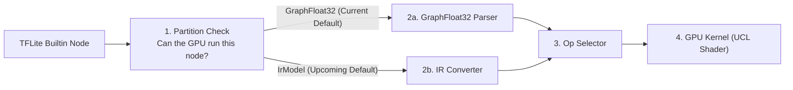

# Adding a Builtin GPU Operator

LiteRT's GPU accelerator currently covers fewer TFLite builtin operators than the CPU runtime. When a model hits an unsupported builtin operator, LiteRT falls back to the CPU, which introduces graph partitioning and host-device synchronization overhead.

If you want to add GPU support for a missing TFLite builtin operator (such as ScatterND), all of your changes stay self-contained inside this directory. Builtin operators are already recognized by the TFLite and LiteRT op resolvers, so no changes are needed in the LiteRT runtime. You also do not need to modify the upstream ML Drift repository—this delegate provides extension hooks where new builtin GPU kernels can be added directly.

This document is split into two parts:
- **Part 1** gives a short architectural overview for human contributors.
- **Part 2** provides exact file paths, symbol names, and code templates for AI coding agents (or contributors looking for copy-paste boilerplate).

## Part 1: Contributor Overview

Adding a builtin operator to the GPU delegate follows four stages from the TFLite flatbuffer graph down to GPU shader execution:



### 1. Partition Check

When preparing a model, TFLite asks the GPU delegate which nodes it can accelerate. You start by adding a small validation function that checks operator version, input and output counts, tensor data types, and whether parameters such as axes or output shapes are compile-time constants. If a node uses an unsupported configuration, rejecting it here lets TFLite safely keep that node on the CPU.

See the [Cumsum support check](tflite/support/support_cumsum.cc) for a clean, self-contained example.

### 2. Graph Conversion

Accepted TFLite nodes are lowered into ML Drift's internal graph representation, extracting any static operator attributes along the way.

The delegate is currently transitioning from its original graph representation (**GraphFloat32**, today's default) to a newer IR pipeline (**IrModel**, the upcoming default). Adding converters for both pipelines ensures your operator works by default today and remains compatible once IrModel becomes the default. Compare the [Cumsum IR converter](tflite/convert/convert_cumsum.cc) and the Cumsum parser in [model_builder.cc](tflite/model_builder.cc) to see how both paths map the same operator.

### 3. GPU Kernel Implementation

New builtin GPU kernels should live in a dedicated `delegate/extension/` directory so they stay separate from the StableHLO composite operators under `delegate/composite/`.

Kernels are written in ML Drift's Unified Compute Language (UCL), a lightweight shader DSL that compiles a single kernel implementation to OpenCL, WebGPU, Metal, and Vulkan. You define the dispatch grid size, bind input and output tensors, and write the compute shader body. For shader syntax and kernel patterns, see the [ML Drift kernel authoring guide](https://github.com/google-ai-edge/ml-drift/blob/main/docs/skills/add-new-kernel/SKILL.md) and the in-repo [GLU kernel](delegate/composite/glu_kernel.cc).

### 4. Op Selection and Testing

Finally, register your operator in both the GraphFloat32 and IrModel op selectors so they dispatch to your new kernel before falling back to upstream ML Drift operators. Note that the selector files currently live under `delegate/composite/` for historical reasons; you can either invoke your `delegate/extension/` kernel from there or move the selector into `delegate/extension/` as more operators are added.

Verify your implementation with unit tests covering support validation and graph conversion, plus an end-to-end GPU execution test comparing outputs against the TFLite CPU reference in both FP32 and FP16 precision across both graph pipelines.

---

## Part 2: Reference for Coding Agents

*This section provides exact file paths, function signatures, and boilerplate templates intended for AI coding agents and step-by-step implementation.*

### File Map (`ml_drift_delegate/...`)

| Stage | Files to Add / Edit | Reference |
| :--- | :--- | :--- |
| **1. Support Check** | `tflite/support/support_<op>.{h,cc}`<br/>`tflite/support/support.cc`<br/>`tflite/support/BUILD` | `tflite/support/support_cumsum.{h,cc}` |
| **2a. GraphFloat32 Parser** | `tflite/model_builder.cc` (`use_ir_model = false`, current default) | `CumsumOperationParser` in `tflite/model_builder.cc` |
| **2b. IR Converter** | `tflite/convert/convert_<op>.{h,cc}`<br/>`tflite/ir_model_builder.cc`<br/>`tflite/convert/BUILD` (`use_ir_model = true`, upcoming default) | `tflite/convert/convert_cumsum.{h,cc}` |
| **3. GPU Kernel** | `delegate/extension/<op>_kernel.{h,cc}`<br/>`delegate/extension/BUILD` | `delegate/composite/glu_kernel.{h,cc}` |
| **4. Op Selectors** | `delegate/composite/litert_op_selector.cc`<br/>`delegate/composite/ir/litert_op_selector.cc` | `CreateGluFromNode` in `litert_op_selector.cc` |
| **5. Tests** | `tflite/support/support_<op>_test.cc`<br/>`tflite/convert/convert_<op>_test.cc` | `support_cumsum_test.cc`, `convert_cumsum_test.cc` |

### Step 1: Partitioning Support Check

Create `ml_drift_delegate/tflite/support/support_<op>.{h,cc}` using helpers from `support_aux.h` (`CheckInputOutputCounts`, `ValidateTensorIds`, `CheckTensorDtype`, `CheckIsConstant`, `CheckNotConstant`), then wire it into `IsNodeSupported` in `ml_drift_delegate/tflite/support/support.cc`:

```cpp
auto scatter_nd = absl::bind_front(IsScatterNdSupported, context, node,
                                   registration, error);
// Inside switch (registration->builtin_code):
case kTfLiteBuiltinScatterNd: return scatter_nd();
```

### Step 2a: `GraphFloat32` Parser (Current Default)

Add a `TFLiteOperationParser` subclass in `ml_drift_delegate/tflite/model_builder.cc` and return it from `NewOperationParser` for `case kTfLiteBuiltinScatterNd:`:

```cpp
class ScatterNdOperationParser : public TFLiteOperationParser {
 public:
  absl::Status IsSupported(const TfLiteContext* context,
                           const TfLiteNode* tflite_node,
                           const TfLiteRegistration* registration) final {
    std::string error;
    if (!ir::IsScatterNdSupported(context, tflite_node, registration, &error)) {
      return absl::InvalidArgumentError(error);
    }
    return absl::OkStatus();
  }

  absl::Status Parse(const TfLiteNode* tflite_node,
                     const TfLiteRegistration* registration,
                     ::ml_drift::GraphFloat32* graph,
                     ObjectReader* reader) final {
    ::ml_drift::Node* node = graph->NewNode();
    node->operation.type = "scatter_nd";
    node->operation.attributes = ir::ScatterNdAttributes{/*...*/};
    // Connect inputs/outputs via reader->ReadValue(...) and graph->AddConsumer/SetProducer.
    return absl::OkStatus();
  }
};
```

### Step 2b: `IrModel` Converter (Upcoming Default)

Create `ml_drift_delegate/tflite/convert/convert_<op>.{h,cc}` and wire `kTfLiteBuiltinScatterNd` inside `ConvertNode(...)` in `ml_drift_delegate/tflite/ir_model_builder.cc`:

```cpp
struct ScatterNdAttributes {
  // Parsed static attributes needed by the GPU kernel.
};

void ConvertScatterNd(
    const TfLiteContext& context, const TfLiteNode& node,
    const TfLiteRegistration& registration,
    absl::flat_hash_map<int, ::ml_drift::ir::IrTensorId>& tensor_map,
    ::ml_drift::ir::IrModel& ir_model) {
  ::ml_drift::ir::IrOp* op = ir_model.add_op();
  op->name = "scatter_nd";
  op->attr = ScatterNdAttributes{/*...*/};

  for (int i = 0; i < node.inputs->size; ++i) {
    ir_model.AddConsumer(tensor_map.at(node.inputs->data[i]), op->id);
  }
  ir_model.SetProducer(tensor_map.at(node.outputs->data[0]), op->id);
}
```

### Step 3: UCL GPU Kernel (`delegate/extension/<op>_kernel.{h,cc}`)

Subclass `::ml_drift::GPUOperation` (following [add-new-kernel/SKILL.md](https://github.com/google-ai-edge/ml-drift/blob/main/docs/skills/add-new-kernel/SKILL.md)) and append it to `::ml_drift::GpuModelBuilder`:

```cpp
auto gpu_op = CreateScatterNdOp(src_descs, dst_desc, attr);
auto src_handles = /* model_builder->GetTensor(input_ids[i]) */;
auto dst_handle = model_builder->AddTensor(dst_desc);
model_builder->AddOperation(std::move(gpu_op), src_handles, {dst_handle});
model_builder->UpdateOutputTensor(dst_handle, output_id);
```

### Step 4: Wire Into `LiteRtOpSelector`

Intercept `"scatter_nd"` in both selectors before the fallback call to `::ml_drift::GPUOperationFromNode(...)`:

```cpp
// ml_drift_delegate/delegate/composite/litert_op_selector.cc
if (node.operation.type == "scatter_nd") {
  return CreateScatterNdFromNode(inputs, outputs, node, model_builder);
}

// ml_drift_delegate/delegate/composite/ir/litert_op_selector.cc
if (ir_op.name == "scatter_nd") {
  return CreateScatterNdFromIrOp(inputs, outputs, ir_op, model_builder);
}
```

### Step 5: Test Commands

```bash
bazel test //ml_drift_delegate/tflite/support:support_<op>_test \
           //ml_drift_delegate/tflite/convert:convert_<op>_test
```
